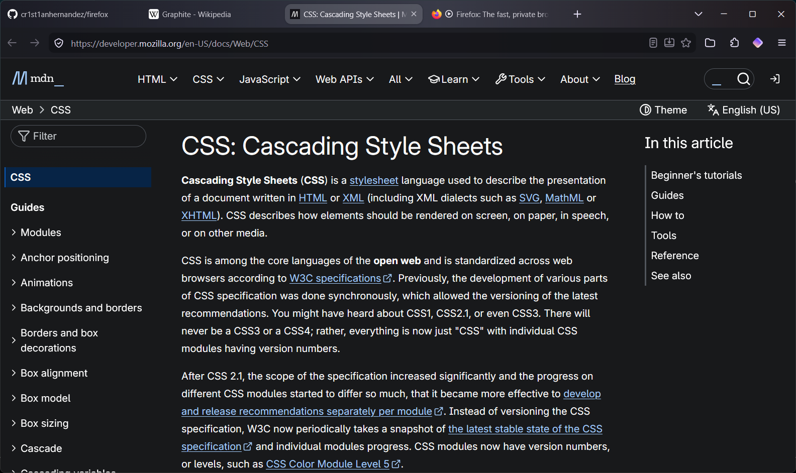
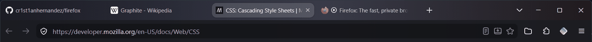
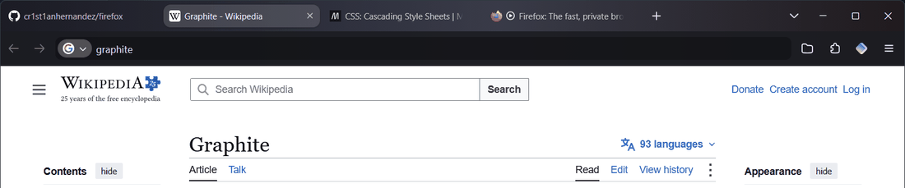
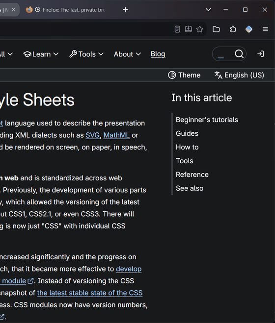
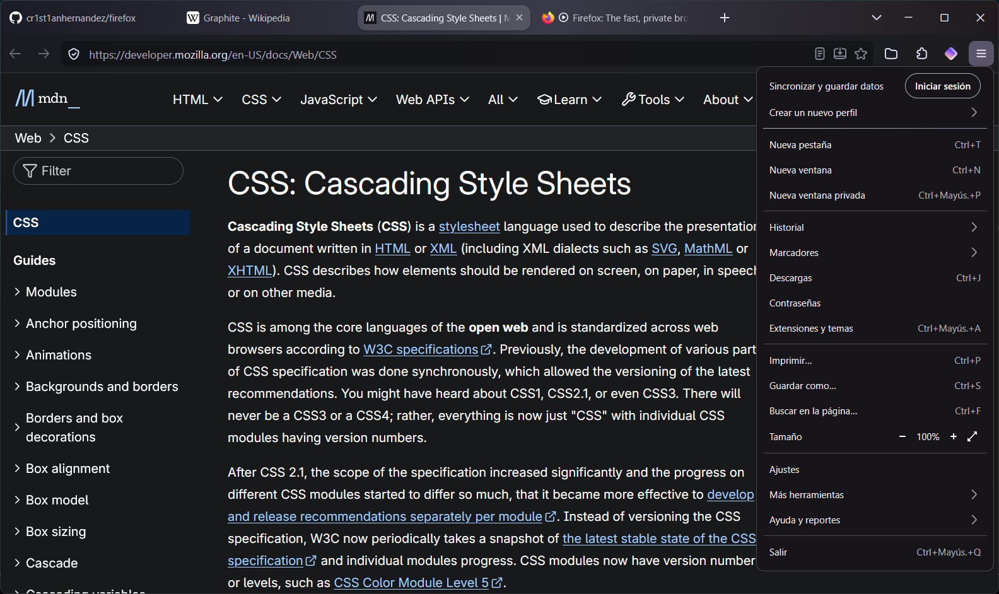
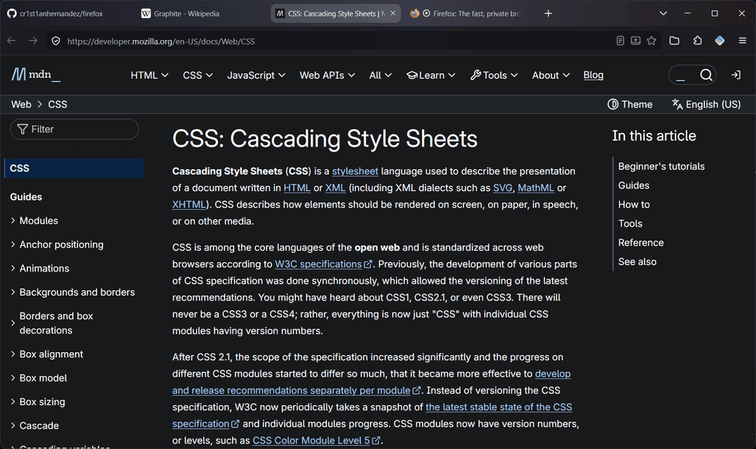

# Grafito

A dark graphite `userChrome.css` theme for Firefox on Windows 11. It has rounded shapes, a quiet colour palette, and soft animations that use only `transform` and `opacity`.

## Features

### Tabs
Tabs fade in when they open and lift slightly on hover. The close button (✕) only appears on hover. A loading bar runs while a page loads, and the audio icon glows softly.

### URL bar
The URL bar gets an accent glow when focused, and the results drop in one after another.

### Menus and panels
Panels such as ☰, downloads and extensions drop in and scale smoothly. Submenus, the menu bar and bookmark folders fade in.

### Tab switching
Page content fades in softly when you switch tabs.

## Installation

1. Open `about:support`, find **Profile Folder** and click **Open Folder**.
2. Copy the `chrome/` folder and `user.js` into that profile folder.
3. Go to **Settings → General → Appearance** and choose Firefox's **Dark** theme.
4. Restart Firefox twice. The second restart also shows the native loading screen.

`user.js` already enables `toolkit.legacyUserProfileCustomizations.stylesheets`, so you don't need to change anything in `about:config`.

## What `user.js` changes

`user.js` is optional. You can install only `chrome/userChrome.css`, as long as you turn on `toolkit.legacyUserProfileCustomizations.stylesheets` yourself. Read the file before copying it, because it also includes personal preferences:

| Setting | Why |
|---|---|
| `widget.windows.mica = false` | Prevents a grey flash at startup (see below). |
| `browser.startup.blankWindow = true` | Shows Firefox's native skeleton loading screen. |
| `ui.prefersReducedMotion = 0` | Keeps the animations on even when Windows *Animation effects* is off. Delete it if you want Windows to decide. |
| `general.smoothScroll.msdPhysics.*` | Physics-based (MSD) smooth scrolling. `mousewheel.default.delta_multiplier_y` sets the speed. |
| `full-screen-api.transition-duration.*` | Fades when entering or leaving full screen. |
| `layout.frame_rate = 72` | **Set this to your monitor's refresh rate**, or delete it. |
| `signon.*`, `browser.translations.*`, `browser.urlbar.trim*`, `full-screen-api.warning.*` | Personal preferences: no password saving, no translation pop-up, full URLs shown, no full-screen warning. Remove any you don't want. |

## Startup without a grey flash

Windows' acrylic and Mica backdrops are both off. With either of them on, Windows paints the raw backdrop (a grey rectangle) before Firefox draws its first frame. Without a backdrop, Firefox uses its native loading screen (*skeleton UI*). That screen needs `browser.startup.blankWindow = true` and a built-in theme (Default, Light or Dark).

## Animations

Every animation respects `prefers-reduced-motion`, so the Windows *Animation effects* switch turns them off. Note that `user.js` overrides that switch with `ui.prefersReducedMotion = 0`. Top-level context menus can't be animated from CSS.

## Compatibility

Tested on **Firefox 158** on **Windows 11**. Other platforms may work but haven't been tested.

## License

[MIT](LICENSE)
